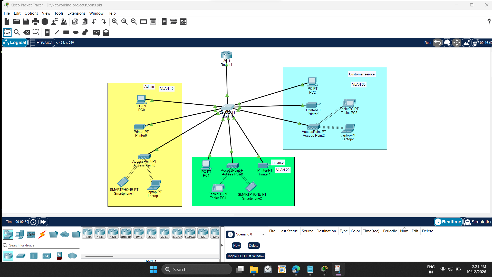
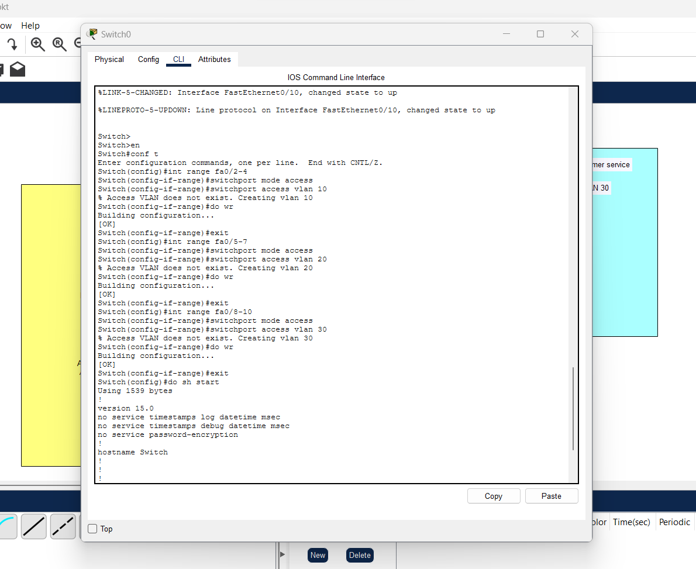
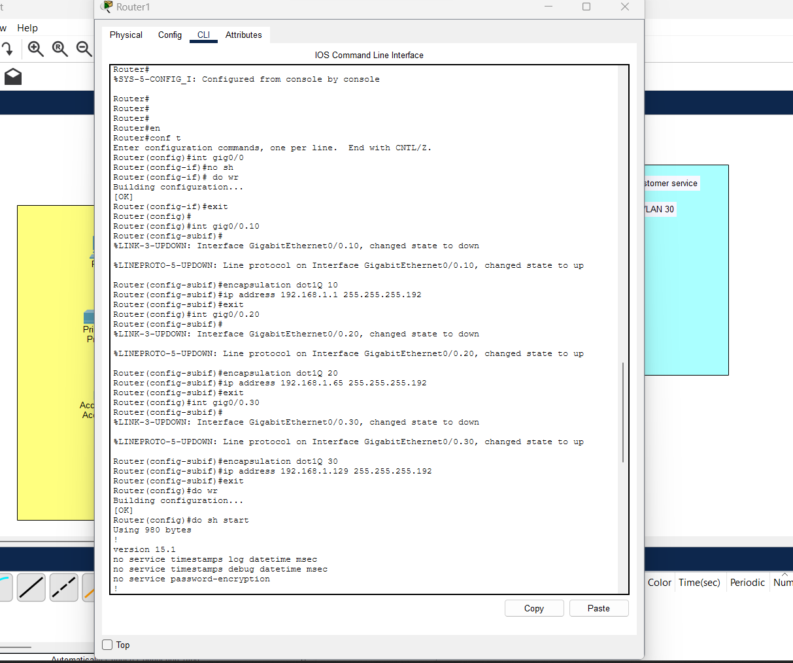
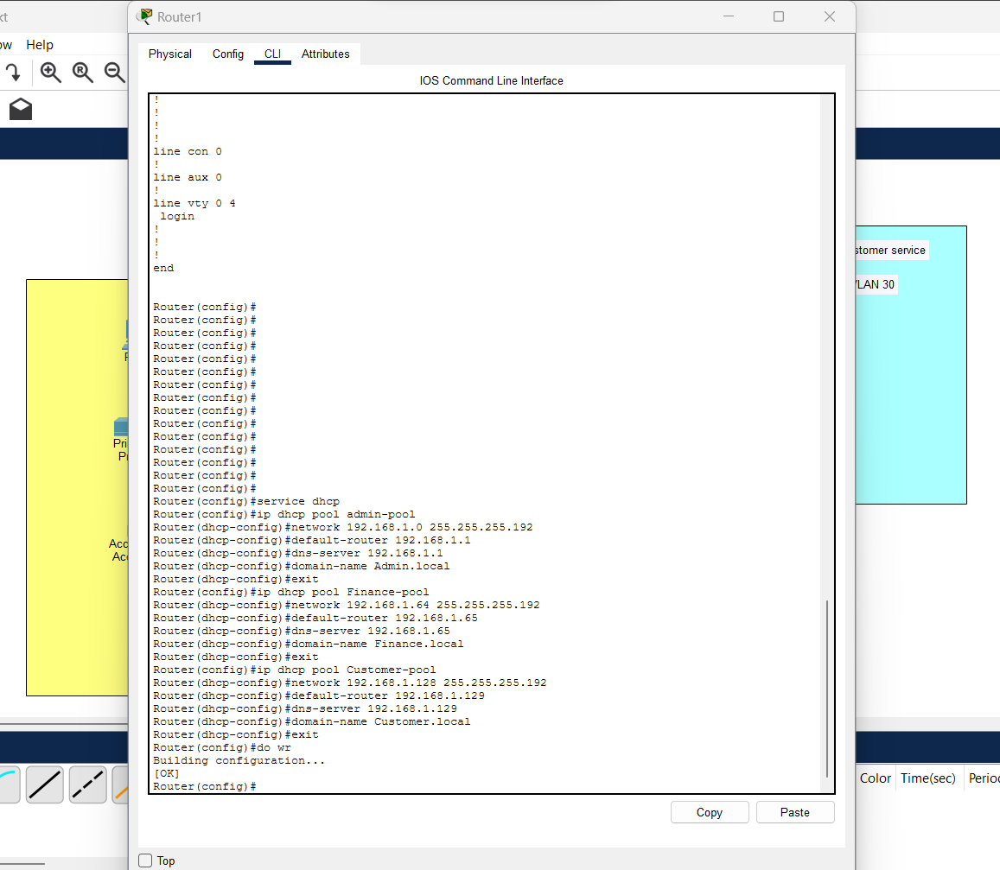
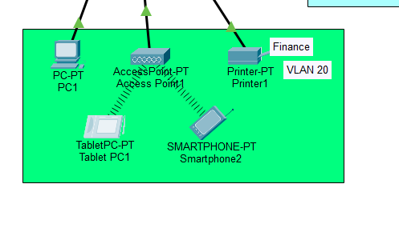
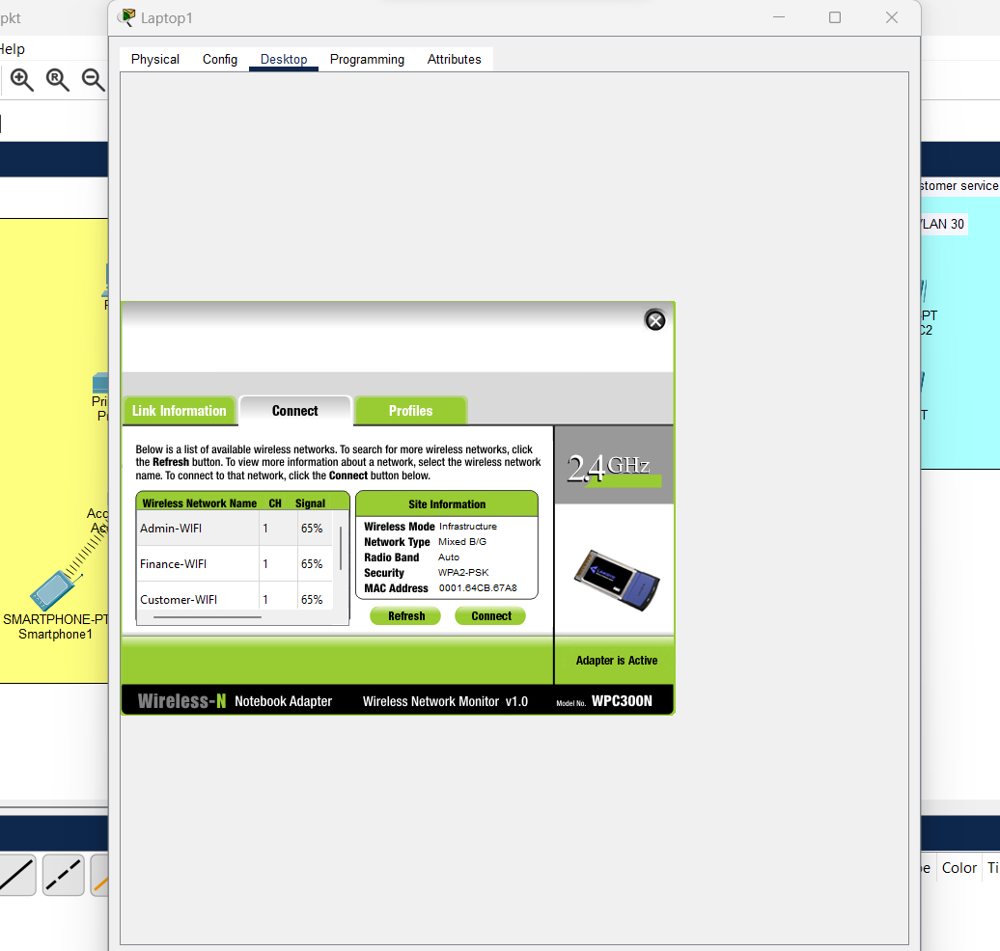

# Simple Office Networking Design using CISCO packet tracer.

Case Study: ABC company deals with selling and buying of items which are basically operated from the headquearters. the company is intending to open a branch near the local village the company requires young IT graduates to design the network for the branch the network is intended to operate separately from the HQ network.

Being a small network the company the following requirements during implementation:

a) One router and one switch to be used (all CISCO products)
b) 3 departments (Admin/IT, Finance/HR and customer service/Reception)
c) Each department is required to be in different VLANS.
d) Each department is required to have wireless network for the users.
e) Host devices in the network are required to obtain IPv4 address automatically.
f) Device in all the departments are required to communicate with each other.

Assume the ISP gave out a base network of 192.168.1.0 you as the young network engineer who has been hired, design and implement a network considering the above requirements.

# Installing Components in Cisco packet tracer:

Picking components router, pc, switch, printers and so on bottom of the screen in the cisco packet tracer

Connecting router, switch, pc and other components using fast ethernet cable. for each department consist admin, finance, customer service.

# Subnetting Calculation
Base network: 192.168.1.0

No. of subnets = 3

No. of subnts = 2^n

2^n = 3

n= 2

class c 255.255.255.0 -> 11111111.11111111.11111111.00000000

After borrowing 2 bits can make 4 subnets

255.255.255.192 -> 11111111.11111111.11111111.11000000

Block size 64 which mean can connet 64 device each subnet(4).

First Subnet

Network IP     : 192.168.1.0
Host Range    : 192.168.1.1 - 192.168.1.62
Broadcast IP  : 192.168.1.63

Second Subnet

Network IP     : 192.168.1.64
Host Range    : 192.168.1.65 - 192.168.1.126
Broadcast IP  : 192.168.1.127

Third Subnet

Network IP     : 192.168.1.128
Host Range    : 192.168.1.129 - 192.168.1.190
Broadcast IP  : 192.168.1.191

Fourth Subnet 

Network IP     : 192.168.1.192
Host Range    : 192.168.1.123 - 192.168.1.253
Broadcast IP  : 192.168.1.254

# Screenshot

Demonstration video link https://youtu.be/R4eTRr4aPu4?si=A51NGjFCS70GV4TA

# Setup Virtual local network

Creating VLAN for each department enable dividing single physical switch port to separate group of logical port to isolate the network it enhance security and speed of packet travel.

# Screenshot

Demonstration video link https://youtu.be/R4eTRr4aPu4?si=A51NGjFCS70GV4TA?t=627

# Configuring router to make communication amoung the departments

Here make communication amoung the different VLANs 10, 20 30.
- Comment lines in router.
> en;
>conf t;
>int gig0/0;
>no sh;
>do wr;
>exit;

- The above comment line defines enabling gig0/0 ethernet cable which in router to communicate all the networks

>int gig0/0.10;
>encapsulation dot1Q 10;
>ip address 192.168.1.1 255.255.255.192;
>exit;

- Above comment line make a traffic tag ID for VLAN 10 (Admin department) to communicate through gig0/0 ethernet and assigning IP address for this network.

>int gig0/0.20;
>encapsulation dot1Q 20;
>ip address 192.168.1.65 255.255.255.192;
>exit;

- Above comment line make a traffic tag ID for VLAN 20 (Finance department) to communicate through gig0/0 ethernet and assigning IP address for this network.

>int gig0/0.30;
>encapsulation dot1Q 30;
>ip address 192.168.129 225.255.255.192;
>do wr;
>exit;
>do sh start;

- Above comment line make a traffic tag ID for VLAN 20 (Finance department) to communicate through gig0/0 ethernet and assigning IP address for this network.

# Screenshot

#DHCP configuration for assign IP automatically

config> service dhcp;
>ip dhcp pool Admin-local;
>network 192.168.1.0 255.255.255.192;
>default-router 192.168.1.1;
>dns-server 192.168.1.1;
>domain-name Admin.local;
>exit;

dncp conf 2nd subnet

>ip dhcp pool Finance-local;
>network 192.168.1.64 255.255.255.192;
>default-router 192.168.1.65;
>dns-server 192.168.1.65;
>domain-name Finance.local;
>exit;

dhcp conf 3rd subnet

>ip dhcp pool Customer-local;
>network 192.168.1.128 255.255.255.192;
>default-router 192.168.1.129;
>dns-server 192.168.1.129;
>domain-name Customer.local;
>exit;

>do wr;

- Above lines denotes DHCP configuration for assigning ip for every device in each network automatically.

# Screenshot

Demonstration video link https://youtu.be/R4eTRr4aPu4?si=A51NGjFCS70GV4TA?t=977

# Wireless connectivity using access point device.

To provide Wi-Fi for smartphones, laptops, and tablets in your Cisco Packet Tracer office network, you can connect a wireless access point (AP) to your switch. The wireless devices will connect to the AP, and the AP will bridge their traffic into your office VLAN.

# Screenshot

Demonstration video link https://youtu.be/R4eTRr4aPu4?si=A51NGjFCS70GV4TA?t=1695

